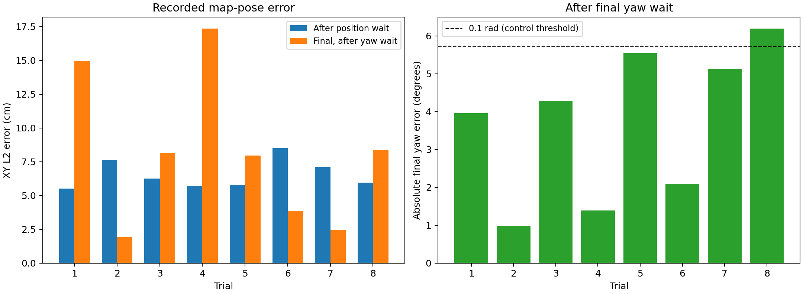

# G1 PosNav 末端精调实验报告

实验包：`20261109T151158Z`；实验时间：2026-11-09 23:11:58 至 2026-11-09 23:18:57（北京时间）。

## 结果

本组 8 次任务均完成完整 PosNav 流程。最终 L2 平均 **8.13 cm**，
中位数 **8.04 cm**，范围 **1.93–17.36 cm**。
最终 yaw 误差绝对值平均 **3.70°**（0.06453 rad），
中位数 **4.12°**，范围 **0.99–6.19°**。
L2 均方根为 9.68 cm，yaw 误差均方根为 4.13°。

3/8 次 L2 不超过 5 cm，6/8 次不超过 10 cm；7/8 次最终 yaw 误差绝对值不超过
0.1 rad；同时满足 L2≤10 cm 和 yaw≤0.1 rad 的有 5/8 次。这些是描述性统计，
不是与上层约定的验收规则，也不是总体任务成功率估计。

RViz 中箭头几乎重合与部分试验的厘米级误差相符；但本组第 1、4 次最终 L2
分别为 14.97、17.36 cm，不能据视觉重合认定每次都达到几厘米精度。
可以表述为“8 次完整任务中，最终定位坐标误差平均约 8.1 cm，yaw 绝对误差平均约 3.7°”。

## 指标口径

采用每次 `result.json.final_pose`，即最终 yaw 停止后等待约 0.75 s、记录本轮完成时
控制器使用的定位位姿。与 `fine_approach_completed` 事件及轨迹对应最新样本逐一核对，
结果一致；不是位置阶段刚停止时的位姿，也不是任务途中最接近目标的样本。

```text
L2 = hypot(final_x-goal_x, final_y-goal_y)
e_yaw = atan2(sin(goal_yaw-final_yaw), cos(goal_yaw-final_yaw))
```

角差取 [-π,π] 的最短有符号误差；均值等统计使用绝对值，避免正负抵消。
例如第 4 次目标 yaw 为 +π、最终 yaw 接近 -π，实际误差约 1.39°，不按接近一整圈计算。
最终位姿接收年龄为 0.017–0.182 s。
指标反映 map 定位坐标与请求目标的差异，本报告不进行独立物理真值标定。

## 逐次结果

| 任务 | 最终 L2（cm） | 最终有符号 yaw 误差（rad） | 最终 yaw 绝对误差（°） | 位置等待结束 L2（cm） |
|---|---:|---:|---:|---:|
| 1 | 14.97 | -0.06904 | 3.96 | 5.52 |
| 2 | 1.93 | -0.01727 | 0.99 | 7.65 |
| 3 | 8.13 | -0.07471 | 4.28 | 6.27 |
| 4 | 17.36 | -0.02427 | 1.39 | 5.71 |
| 5 | 7.96 | +0.09685 | 5.55 | 5.80 |
| 6 | 3.88 | +0.03667 | 2.10 | 8.52 |
| 7 | 2.47 | -0.08940 | 5.12 | 7.12 |
| 8 | 8.37 | +0.10805 | 6.19 | 5.95 |



第 8 次最终 yaw 误差为 0.10805 rad，略大于控制停止阈值 0.1 rad。
停止阈值作用于发出零速度的时刻，之后的等待仍可能改变实际记录角度；当前实现没有
停后再次修正或验收。`success=true` 表示本轮流程完成，不能直接解释为误差阈值全部达标。

位置等待结束的 L2 与最终 L2 有时增大、有时减小，CSV 同时保存两个阶段的误差、
阶段间 XY 位移和 yaw 停止瞬间误差。阶段间位移包括最终转向和零速等待期间的定位变化，
不能全部归为纯转向机械位移；最终指标统一使用整个流程结束后的位姿。

## 本次实现与参数

- 所有 STG 针对 pre，pre 位于目标 yaw 反方向 0.60 m，末端以最新实际位姿接近目标。
- 位置阶段开始时固定实际位置到目标的方向，用有符号投影剩余距离停止，`coast=0 m`。
- 投影剩余距离≤0.15 m 时停止角度修正，继续以 `fine_speed=0.25 m/s` 前进，受阻处理仍优先。
- `drive_align=yaw_stop_tol=0.1 rad`，`k_ang=1.5`，`wz_min=0.15 rad/s`，`wz_max=1 rad/s`。
- 位置停止等待 0.50 s，最终 yaw 停止等待 0.75 s；只执行一轮位置接近及 yaw 对准。
- 全组有 8 条完整阶段事件链，无自动脱困事件；本报告不由此推断脱困能力。

参数来自实验包的配置和源码快照。本次分析没有调整运控参数。

## 数据完整性与复现

原包 [本地目录](../../posnav_experiments/20261109T151158Z/) 完整保留；
原包 `checksums.sha256` 中 **234 个文件全部校验通过**。
session、navigation_recording 和 8 份 result 均正常收尾，记录器无写盘错误、无队列丢弃。
所有 trial 均纳入统计，没有按误差筛选或剔除异常值；记录器无丢弃不代表 DDS 消息零丢失。

- [逐次数据 CSV](per_trial.csv)：目标与最终位姿、XY 分量、L2、yaw、阶段误差及等待时间。
- [机器可读摘要](summary.json)：完整参数、统计量及逐次结果。
- [图 PNG](final_pose_errors.png) / [图 PDF](final_pose_errors.pdf)。
- [复现脚本](analyze.py)：读取原始包后重新计算，图导出需要 matplotlib，其余使用 Python 标准库。
- [报告产物校验清单](checksums.sha256)。

在 RealWorldG1 根目录执行 `python3 diagnostics/posnav_final_approach_20261109/analyze.py`。
原始实验包留本地；报告、统计数据、配图和脚本按 diagnostics 归档规则保留。
