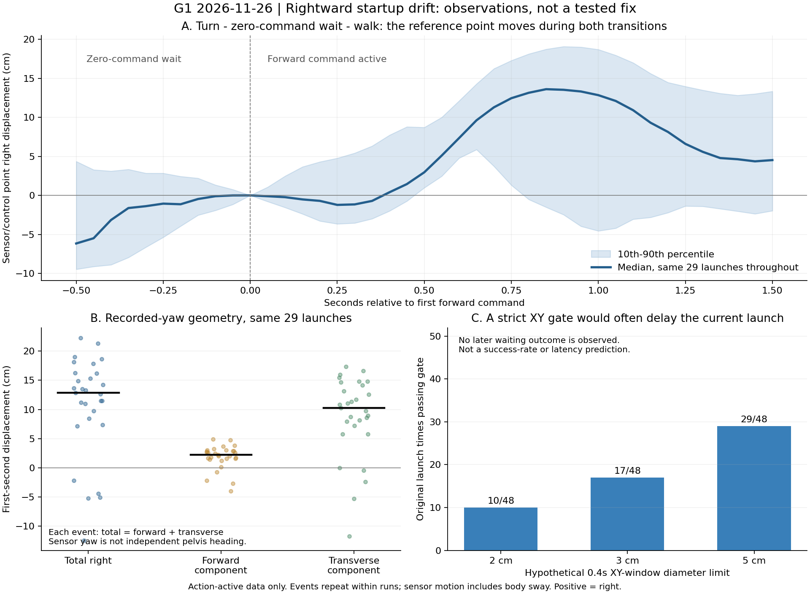

# G1 转停起步右偏：2026-11-26分析

结论是优先处理转停起步的横向过渡、控制参考点摆动和行进阶段缺少回线反馈。
这次只归档分析，相关控制方案尚未实现。

## 数据口径

14趟运行期间无人干预，Action返回后可能立即遥控返回，所有主指标截到Action结果。
视频对应最后一趟，跟随拍摄、初段脚底裁切且无共同时间码，只用于定性判断。
位置来自FAST-LIO/控制参考点，不能全部解释为脚底或骨盆的实际位移。
同一趟有多个事件，样本相关，方向/时长组也不是随机配对试验。
原日志和视频留在本地，此处只提交筛选后的汇总与图。

## 主要观察

- 49段转后起步的0.5秒右移中位3.62cm，39段超过2cm，没有左移超过2cm的事件。
  按最后活动旋转指令正/负分组，两组右移中位分别2.95/4.38cm；
  最后一次小修正方向不一定等于整个转弯方向，不能据此拟合左右补偿。
- 固定29段同时覆盖命令前0.5秒到后1.5秒，命令前已有横移，
  后0.9秒右移中位13.53cm、后1.5秒4.52cm，呈峰值与回摆。
- 对同29段首秒逐段按记录yaw做几何分解，总右移中位12.84cm，
  沿当时朝向前进的右向分量中位2.26cm，垂直该朝向分量中位10.28cm。
  每事件分量严格相加等于总量，组中位数不要求相加；这是几何分解，不是原因占比。
- 假想在起步前0.4秒要求XY窗直径≤2/3/5cm，48次可评估起步分别只有10/17/29次
  能在原时刻放行。日志未观测新策略阻止起步后的等待结果，不能预测通过率、等待时间或改善幅度。
- 前轮用完整三维固定ICP参考重投影原FAST-LIO，侧移仍存在，匹配窗口ICP更新贡献不足1cm。
  当前主解释不应只归于ICP跳变。

## 处理优先级

1. 补完整姿态、同步腰关节/可用机身IMU和API返回，核查控制参考点与实际指令坐标系。
   当前记录只有yaw，无法定量去除上身侧倾的杠杆位移；跨活动关节的参考点不能只减固定XY偏置。
2. 远段复用已有固定STG轴，温和地结合横偏与航向回线，配滤波、死区、限幅和变化率限制。
   只保持起步yaw会使已有横偏平行延续；小wz也不能瞬间消掉第一步峰值。
   新转向/侧移指令产生的短时轨迹和身体包络需要停止带审核。
3. 起步渐变单独A/B。低vx可能只是推迟迈步，现有粗走恒定0.5m/s的数据不能辨识死区或证明渐变收益。
   vy响应与坐标系确认后再考虑独立开关，不先套固定向左补偿。
4. 保留近30cm禁方向重调、原15cm收步、停止带分离及后续STG40cm门。
   如加XY停稳，须有界等待、独立源证据和明确失效行为，避免照搬严格门产生等待循环。

## 可借鉴资料及限制

[TEAM Z的G1试验](https://team-z.co.jp/blog/g1-slope-walking-improvement)使用横偏/横向速度反馈与坐标变换，
可借结构；它依赖仿真位姿，未验证本机原厂步态、FAST-LIO或实机环境，不能照搬增益。

[Unitree官方G1接口](https://github.com/unitreerobotics/unitree_sdk2/blob/master/include/unitree/robot/g1/loco/g1_loco_client.hpp)中，
Move的continuous参数改变速度命令持续时间，ContinuousGait调用平衡模式设置，两者应分别核对。
本次没有切换机器人模式，也未确认所谓所有G1都固定右脚先迈的原厂缺陷。
